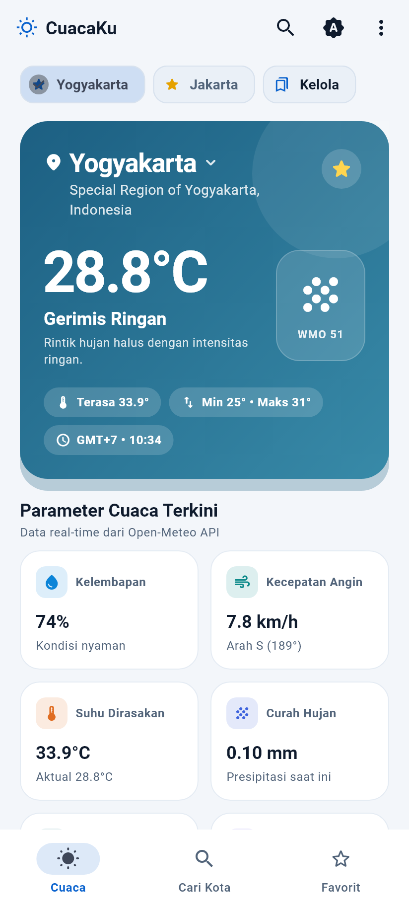
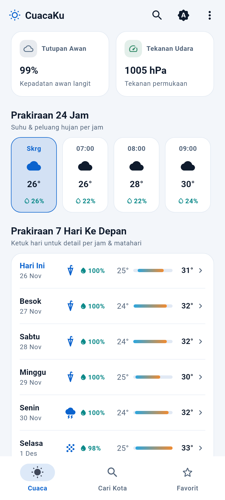
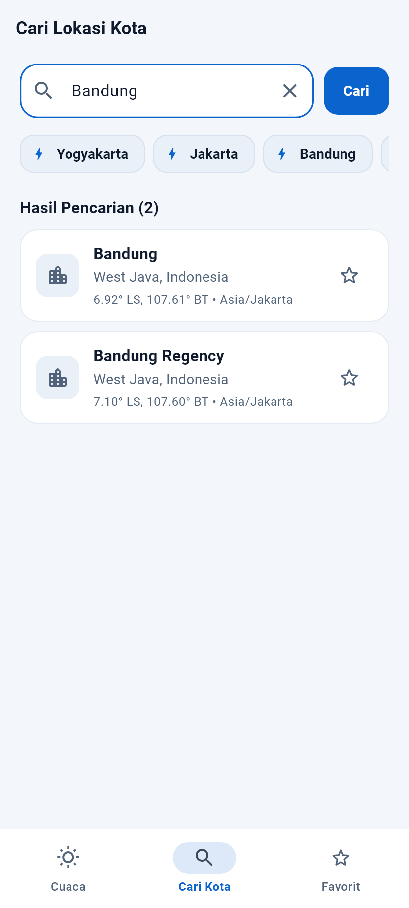
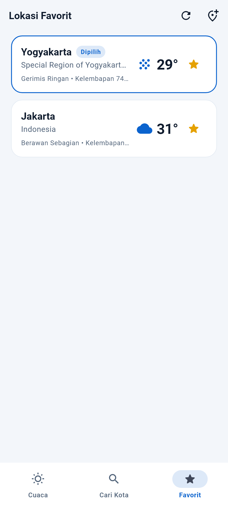
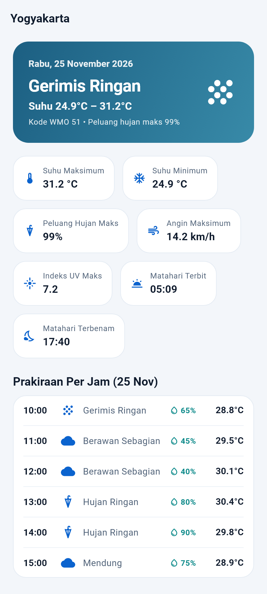

# CuacaKu — Aplikasi Prakiraan Cuaca Flutter (MVVM + Open-Meteo API)

Aplikasi mobile & web Flutter untuk menampilkan informasi cuaca terkini dan prakiraan beberapa hari ke depan menggunakan **REST API Open-Meteo** (Weather Forecast API & Geocoding API) dengan pola arsitektur **Model–View–ViewModel (MVVM)**, desain **Material 3**, tampilan **responsif**, serta penyimpanan lokal (**SharedPreferences**).

> **Catatan Identitas Pengumpulan**  
> - **Nama Mahasiswa:** `Aditya Alfandy`  
> - **NIM:** `H1D024103`  
> - **Shift Awal:** `I`
> - **Shift Akhir:** `H`
> - **Link Video Penjelasan Kode:** `https://youtu.be/z6_qovoGyOc`  

---

## 1. Fitur Utama

### A. Home / Weather Screen
- Menampilkan **nama kota aktif** beserta wilayah/negara, koordinat, dan zona waktu (`timezone=auto`).
- Menampilkan **suhu saat ini** (`current.temperature_2m`) dan **kondisi cuaca terkini** hasil terjemahan kode WMO (`current.weather_code`).
- Menampilkan parameter tambahan wajib & pendukung:
  - **Kelembapan udara** (`current.relative_humidity_2m`)
  - **Kecepatan & arah angin** (`current.wind_speed_10m`, `current.wind_direction_10m`)
  - **Suhu yang dirasakan** (`current.apparent_temperature`)
  - **Curah hujan** (`current.precipitation`)
  - **Peluang hujan maksimum harian** (`daily.precipitation_probability_max`)
  - **Kode kondisi cuaca WMO** (`current.weather_code`)
  - **Tutupan awan** (`current.cloud_cover`), **tekanan udara** (`current.surface_pressure`), **UV maksimum**, **matahari terbit & terbenam**
- Menampilkan **Prakiraan 24 Jam** (`hourly`) dan **Prakiraan 7 Hari ke Depan** (`daily` dengan `temperature_2m_min`, `temperature_2m_max`, `precipitation_probability_max`, dan bilah rentang suhu).
- Mendukung *pull-to-refresh*, ganti cepat antar kota favorit melalui *chips*, tombol bintang favorit, serta mode tema (Sistem / Terang / Gelap).

### B. Search / Location Screen
- Input pencarian nama kota yang memanggil **Open-Meteo Geocoding API** secara langsung (*real HTTP GET*, mendukung *debounce* & tombol **Cari**).
- Menampilkan daftar hasil pencarian (nama kota, provinsi/admin1, negara, koordinat, dan zona waktu).
- Memilih kota dari hasil pencarian otomatis menyimpannya ke **riwayat pencarian lokal**, memuat data cuaca live di Home Screen, dan menyimpannya ke Local Storage.
- Tombol **bintang favorit** pada tiap item untuk menyimpan/menghapus lokasi favorit.
- Saat kolom pencarian kosong, aplikasi menampilkan **Lokasi Favorit** dan **Riwayat Pencarian** yang tersimpan di **SharedPreferences**.

### C. Screen Tambahan
- **Favorites Screen (`FavoritesScreen`)**: Mengelola daftar lokasi favorit tersimpan dan menampilkan ringkasan suhu & kondisi cuaca live dari API Open-Meteo.
- **Daily Detail Screen (`DailyDetailScreen`)**: Menampilkan detail lengkap salah satu hari prakiraan (suhu min/maks, peluang hujan, angin maks, UV maks, matahari terbit/terbenam, serta rincian per jam).

### D. Penanganan State, Responsivitas & Tema
- Penanganan kondisi **Loading**, **Data Kosong** (*empty search*, *empty favorites*, *empty home*), dan **Error** jaringan/API dengan tombol **Coba Lagi**.
- Responsif menggunakan `LayoutBuilder`:
  - Layar sempit (`< 720px`): Bottom `NavigationBar` dan tata letak satu kolom.
  - Layar sedang/lebar (`>= 720px`): Side `NavigationRail` dan tata letak dua kolom pada layar `>= 960px`.
- Material 3 `ThemeData` (Light & Dark) dan `AppTypography` dengan angka tabular (`FontFeature.tabularFigures`) agar nilai suhu dan metrik sejajar rapi.

---

## 2. Struktur Aplikasi & Penerapan Arsitektur MVVM

Proyek ini memisahkan tanggung jawab menjadi lapisan **Model**, **Service**, **ViewModel**, dan **View**:

```text
lib/
├── main.dart                         # Inisialisasi binding, locale id_ID, SharedPreferences, dan MultiProvider
├── app.dart                          # Root widget CuacaKuApp (StatelessWidget) & binding ThemeViewModel
├── theme/
│   ├── app_theme.dart                # Konfigurasi Material 3 Theme (Light & Dark)
│   └── app_typography.dart           # Skala Typography & angka tabular untuk keterbacaan
├── models/
│   ├── location_model.dart           # Model lokasi (fromGeocodingJson, toJson, fromJson)
│   ├── weather_forecast_model.dart   # Model Forecast API (CurrentWeatherModel, HourlyForecastItem, DailyForecastItem)
│   └── weather_condition.dart        # Pemetaan kode WMO -> label Indonesia, deskripsi, ikon, & gradasi warna
├── services/
│   ├── open_meteo_service.dart       # Client HTTP GET untuk Open-Meteo Forecast & Geocoding API
│   └── local_storage_service.dart    # Persistensi lokal via SharedPreferences (favorit, riwayat, kota aktif, tema)
├── viewmodels/
│   ├── weather_viewmodel.dart        # ChangeNotifier: state cuaca kota aktif (initial/loading/loaded/empty/error)
│   ├── search_location_viewmodel.dart# ChangeNotifier: pencarian Geocoding, riwayat, favorit, & preview favorit
│   └── theme_viewmodel.dart          # ChangeNotifier: pengaturan & persistensi mode tema
├── views/
│   ├── main_shell_screen.dart        # Shell navigasi responsif (NavigationBar / NavigationRail)
│   ├── home_weather_screen.dart      # Screen 1 (Wajib): Home / Weather Screen
│   ├── search_location_screen.dart   # Screen 2 (Wajib): Search / Location Screen
│   ├── favorites_screen.dart         # Screen tambahan: Daftar kota favorit & ringkasan cuaca live
│   └── daily_detail_screen.dart      # Screen tambahan: Rincian prakiraan harian & per jam
└── widgets/
    ├── weather_hero_card.dart        # Kartu utama suhu, kota aktif, dan kode WMO
    ├── weather_metrics_grid.dart     # Grid responsif metrik cuaca terkini
    ├── hourly_forecast_strip.dart    # Strip horizontal prakiraan 24 jam
    ├── daily_forecast_list.dart      # Daftar prakiraan 7 hari + thermal range bar
    ├── favorite_chips_bar.dart       # Chip pemilih cepat lokasi favorit di Home Screen
    ├── location_result_tile.dart     # Kartu item hasil pencarian, riwayat, & favorit
    └── weather_state_views.dart      # Tampilan Loading, Empty, dan Error + tombol Retry
```

### Alur Kerja MVVM pada Aplikasi
1. **Model (`lib/models/` & `lib/services/`)**:  
   `OpenMeteoService` melakukan request HTTP `GET` dan mengembalikan JSON mentah yang di-parse oleh `WeatherForecastModel.fromJson(...)` dan `LocationModel.fromGeocodingJson(...)`. `LocalStorageService` menyimpan dan membaca JSON dari `SharedPreferences`. Lapisan ini tidak bergantung pada widget UI (`BuildContext`).
2. **ViewModel (`lib/viewmodels/`)**:  
   `WeatherViewModel`, `SearchLocationViewModel`, dan `ThemeViewModel` mewarisi `ChangeNotifier`. ViewModel mengelola *state* (`status`, `forecast`, `results`, `favorites`, `searchHistory`, `errorMessage`), memanggil service, lalu memanggil `notifyListeners()`.
3. **View (`lib/views/` & `lib/widgets/`)**:  
   Widget mengamati ViewModel melalui `Provider` (`context.watch` / `Consumer`) dan meneruskan aksi pengguna (`selectLocation`, `searchCities`, `toggleFavorite`, `fetchWeather`) ke ViewModel melalui `context.read`. Kombinasi `StatelessWidget` dan `StatefulWidget` digunakan sesuai kebutuhan (misalnya `TextEditingController` & *debounce timer* pada `SearchLocationScreen`).

---

## 3. Implementasi REST API Open-Meteo

Seluruh permintaan dilakukan menggunakan package `http` dengan metode **`GET`**:

1. **Weather Forecast API**  
   - **Endpoint:** `https://api.open-meteo.com/v1/forecast`
   - **Query Parameter:**
     - `latitude` & `longitude`: Koordinat lokasi yang dipilih
     - `current`: `temperature_2m,relative_humidity_2m,apparent_temperature,is_day,precipitation,weather_code,wind_speed_10m,wind_direction_10m,surface_pressure,cloud_cover`
     - `hourly`: `temperature_2m,weather_code,precipitation_probability`
     - `daily`: `weather_code,temperature_2m_max,temperature_2m_min,precipitation_probability_max,sunrise,sunset,uv_index_max,wind_speed_10m_max`
     - `timezone=auto`
     - `forecast_days=7`

2. **Geocoding API**  
   - **Endpoint:** `https://geocoding-api.open-meteo.com/v1/search`
   - **Query Parameter:** `name`, `count=15`, `language=en`, `format=json`
   - **Penanganan Respons Kosong:** Ketika kota tidak ditemukan, Open-Meteo mengembalikan JSON tanpa key `results` (`{"generationtime_ms": ...}`). `OpenMeteoService.searchCities` menanganinya secara aman menjadi list kosong (`[]`) untuk memicu tampilan *empty state*.

---

## 4. Screenshot Aplikasi

| Home / Weather Screen (Utama) | Home Screen (Prakiraan 24 Jam & 7 Hari) | Search / Location Screen |
| :---: | :---: | :---: |
|  |  |  |

| Favorites Screen (Tambahan) | Daily Detail Screen (Tambahan) |
| :---: | :---: |
|  |  |

---

## 5. Cara Menjalankan & Menguji Proyek

```bash
# 1. Unduh dependensi
flutter pub get

# 2. Analisis statis kode
flutter analyze

# 3. Jalankan seluruh unit test & widget test
flutter test

# 4. Jalankan aplikasi (Android / Emulator / Chrome)
flutter run
```
